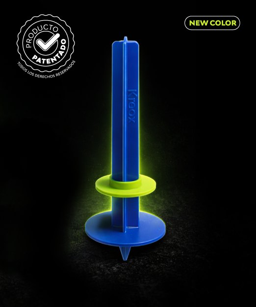
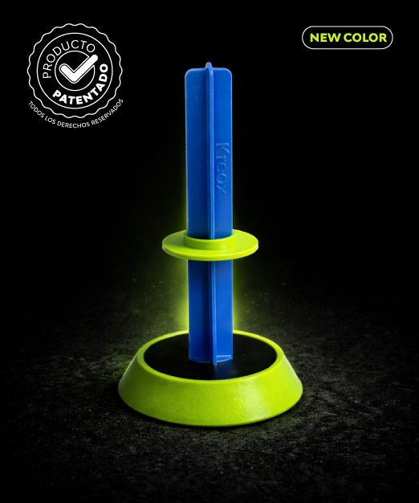

**A screed levelling system is a set of tools that precisely control the height, thickness and spread of the screed while a floor is installed, so the surface comes out perfectly level.** KREOX makes two of them in Spain: the [Insulation Screed Leveller](/en/screed-levellers/insulation-screed-leveller/) for underfloor heating and the [Universal Screed Leveller](/en/screed-levellers/universal-screed-leveller/) for screeds on any surface.

Applying **liquid screed** has become one of the most widely used solutions in modern construction to achieve perfectly level surfaces. However, to achieve **precise, even levelling** it is essential to use specific tools that control the height and thickness of the material during installation.

**Screed levelling systems** make work on site more precise, faster and safer: they guarantee an even surface, reduce errors during application and optimise material use.

## What a screed levelling system is

They are tools designed to precisely control the height, thickness and spread of the screed during floor installation. They are used especially in:

- **Underfloor heating** installations
- Floor screeds
- Levelling surfaces before applying floor finishes
- Technical and industrial floors
- Refurbishment and new-build projects

## Why use professional levellers

Liquid screed flows and levels naturally, but without a control system the thickness can vary or irregularities can appear. Levellers bring:

- **More precision:** the height of the screed is set exactly.
- **More speed:** clear reference points during pouring.
- **Less wasted material:** no excess or shortfall of screed.
- **Professional results:** an even surface, key in technical floors and underfloor heating.

## KREOX levelling solutions

### Insulation Screed Leveller for underfloor heating

The [Insulation Screed Leveller](/en/screed-levellers/insulation-screed-leveller/) is designed for installations over **underfloor heating** insulation boards: it is quick to install, adjusts the height precisely and stays stable during pouring.

### Universal Screed Leveller for screeds

The [Universal Screed Leveller](/en/screed-levellers/universal-screed-leveller/) is a versatile solution for screeds: a base optimised for more stability, precise adjustment, high resistance to continuous use and compatibility with different types of surface.

## Continuous innovation

- **New ring with fibre additive:** more resistance to continuous use, less wear in contact with the screed, firmer adjustment and a longer service life. Its new colour improves visibility on site.
- **Reinforced base on the Universal Screed Leveller:** harder, better behaviour during setting and safer removal of the system.

All these improvements were **tested in real site conditions** before launch.

## Spare parts to extend the life of the system

KREOX offers [spare parts](/en/screed-levellers/spare-parts/) to replace only the parts that wear out: adjustment rings, universal leveller bases and metal rings. This extends the service life of the system without replacing all the equipment.
