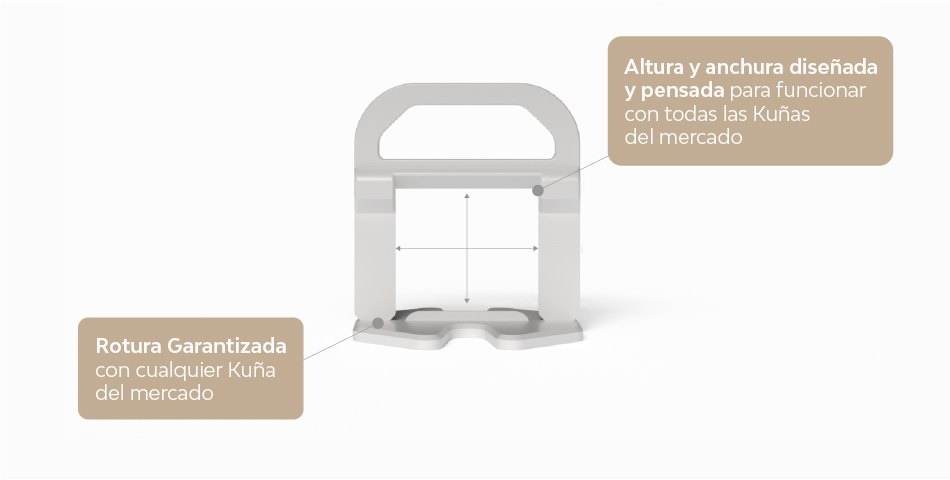

Nuestro [Kalzo Separador](/colocacion-azulejos/kalzo-separador/) es **compatible con todas las kuñas disponibles en el mercado**. Su altura y anchura están diseñadas para asegurar un ajuste perfecto, una rotura limpia y una colocación precisa.

Además es sostenible: desde su concepción hemos priorizado reutilizar al máximo los recursos disponibles.
