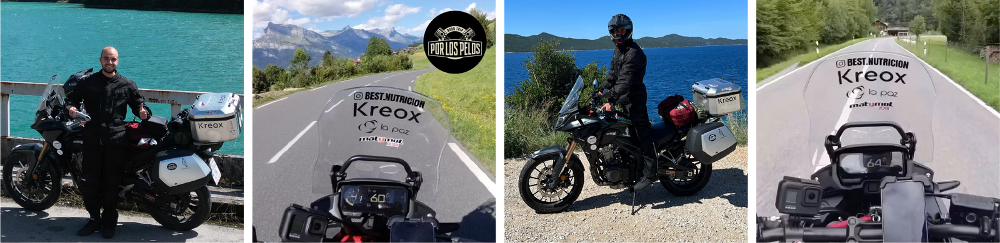

Queremos compartir una historia que nos ha conmovido y en la que hemos aportado nuestro granito de arena.

**Carlos Bernabeu** ([@porlospelosrider](https://www.instagram.com/porlospelosrider/)), un joven de Ibi, emprendió el 5 de agosto un viaje en moto por más de 13 países de Europa para apoyar a la **Asociación Española de Porfiria**, una enfermedad rara y poco conocida. En cada país comparte la historia de los pacientes que conviven con ella.

Desde KREOX nos hemos unido a esta causa. Juntos podemos dar un poco más de esperanza a quienes luchan contra la porfiria.
